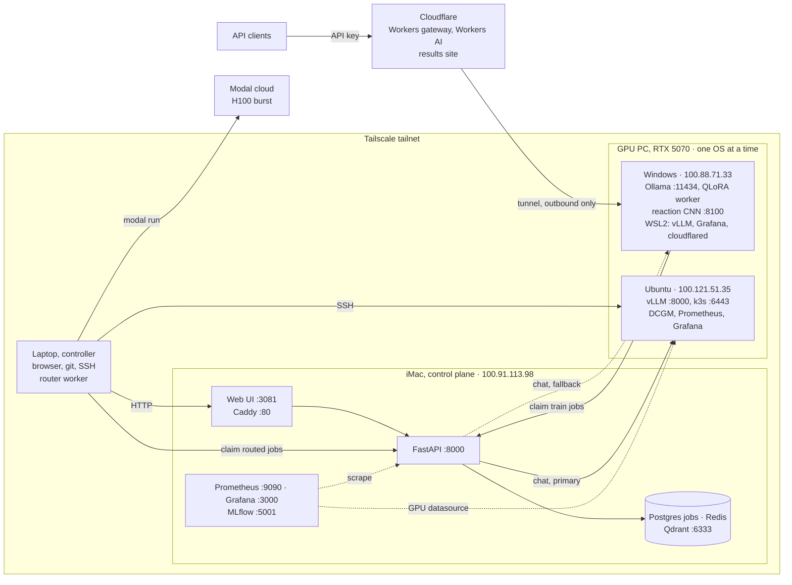

# homelab

**A self-hosted AI platform across three home machines plus cloud GPUs, joined by Tailscale. This repo is its documentation hub.**

     

**homelab (docs hub)** · [homelab-services](https://github.com/zakiscoding/homelab-services) · [homelab-web](https://github.com/zakiscoding/homelab-web) · [homelab-gpu](https://github.com/zakiscoding/homelab-gpu) · [gpu-systems-lab](https://github.com/zakiscoding/gpu-systems-lab) · [gophergrid](https://github.com/zakiscoding/gophergrid)

---

## What's inside

- **Architecture** with diagrams of the whole platform: topology, chat path, job lifecycle, job routing, monitoring — [docs/ARCHITECTURE.md](docs/ARCHITECTURE.md)
- **Node runbooks** for the iMac, the dual-boot GPU PC (Windows and Ubuntu) and the controller laptop
- **Service docs**: web UI, iMac stack, RAG, vision/reactions, observability, MLflow
- **Phase docs** (0A to 6) describing how each capability was built and tested
- **[Setup log](docs/SETUP-LOG.md)**: dated record of every change
- **Public edge on Cloudflare**: an OpenAI-compatible API for the home GPU with per-client keys, a strict rate limit and a hosted fallback, reached through a tunnel with no open ports, plus a public [results page](https://gpu-systems-lab-results.vllm-gateway.workers.dev) — [docs/deploy/public-internet.md](docs/deploy/public-internet.md)
- No code and no secrets. Code lives in the four other repos; credentials stay in `.env` files on each machine.

## Architecture

Full diagrams and explanations: **[docs/ARCHITECTURE.md](docs/ARCHITECTURE.md)**.

## Start here

1. **[Architecture](docs/ARCHITECTURE.md)**: the five diagrams, node and port table, design principles.
2. **[Repositories](docs/REPOS.md)**: which repo runs where and how they are cloned.
3. **[Services](docs/SERVICES.md)**: every running service, URL and config path.
4. **The node you are working on**: [iMac](docs/nodes/imac-node.md) · [GPU PC, Windows](docs/nodes/gpu-node.md) · [GPU PC, Ubuntu](docs/nodes/gpu-node-ubuntu.md) · [Laptop](docs/nodes/controller.md)
5. **[Setup log](docs/SETUP-LOG.md)**: skim the latest entries before changing anything.

Sharing with someone outside the project? Send the standalone **[share/HOMELAB-COMPLETE-OVERVIEW.md](share/HOMELAB-COMPLETE-OVERVIEW.md)**.

## Repo map

| Repo | Role | Runs on |
|------|------|---------|
| **homelab** (this repo) | Docs hub: architecture, nodes, services, setup log, runbooks | Read everywhere |
| [homelab-services](https://github.com/zakiscoding/homelab-services) | iMac stack: FastAPI, Postgres job queue, Redis, Qdrant RAG, Caddy, Prometheus/Grafana, MLflow, iMac worker | iMac (Colima) |
| [homelab-web](https://github.com/zakiscoding/homelab-web) | Next.js 16 / React 19 / Tailwind 4 UI: chat, RAG, reactions, status; BFF keeps the API key server-side | iMac `:3081` (prod), laptop (dev) |
| [homelab-gpu](https://github.com/zakiscoding/homelab-gpu) | Windows GPU PC: Ollama, QLoRA training, GPU job worker, reaction CNN `:8100`, metrics push | GPU PC on Windows |
| [gpu-systems-lab](https://github.com/zakiscoding/gpu-systems-lab) | Ubuntu GPU node + Modal: CUDA kernels, MPI/NCCL, FSDP, vLLM, k3s, DCGM observability, job router, Cloudflare gateway | GPU PC (Ubuntu, or WSL2 on Windows), Modal, Cloudflare, laptop |
| [gophergrid](https://github.com/zakiscoding/gophergrid) | Distributed compute scheduler in Go: gRPC heartbeats, leases, etcd leader election, GPU-aware placement, exactly-once results | iMac (Postgres, etcd, scheduler), laptop (scheduler, worker), GPU PC (worker with the RTX 5070) — [homelab deployment](https://github.com/zakiscoding/gophergrid/blob/main/docs/homelab.md) |

All six repos are public, with secret scanning, push protection and Dependabot alerts on. Details: [docs/REPOS.md](docs/REPOS.md).

## Machines

| Node | Hostname | Tailscale IP | OS | User | Runbook |
|------|----------|--------------|----|------|---------|
| Laptop (controller) | `hp-laptop` | 100.73.132.95 | Windows | `cashh` | [controller.md](docs/nodes/controller.md) |
| iMac (control plane) | `Mos-iMac` | 100.91.113.98 | macOS 15.7, Apple M1 | `momo` | [imac-node.md](docs/nodes/imac-node.md) |
| GPU PC, Windows boot | `zak_pc` | 100.88.71.33 | Windows | `zakar` | [gpu-node.md](docs/nodes/gpu-node.md) |
| GPU PC, Ubuntu boot | `zak-gpu-node` | 100.121.51.35 | Ubuntu 24.04 (external HDD) | `zak` | [gpu-node-ubuntu.md](docs/nodes/gpu-node-ubuntu.md) |
| Cloud | Modal `zakiscoding` | — | gVisor containers | — | [gpu-node-ubuntu.md](docs/nodes/gpu-node-ubuntu.md#cloud-burst-modal) |

The GPU PC (RTX 5070 12 GB, i7-14700F) runs **Windows or Ubuntu, never both**. `cashh` is the
laptop; `zakar` is the GPU PC on Windows.

## Status

| Area | Status | Notes |
|------|--------|-------|
| iMac stack (Colima) | **Running** | API, Postgres, Redis, Qdrant, Caddy, MLflow on `100.91.113.98` |
| Web UI (homelab-web) | **Running** | Chat, RAG, reactions, status at `:3081` (and `:80` via Caddy) |
| Chat backend | **Running** | `LLM_BACKEND=auto`: vLLM on the Ubuntu boot, Ollama on the Windows boot |
| GPU PC, Windows: Ollama | **Done** | `100.88.71.33:11434`, task `HomelabOllamaServe` |
| GPU PC, Ubuntu boot | **Done** | `zak-gpu-node`, CUDA 13.2, Docker, Open MPI — [gpu-node-ubuntu.md](docs/nodes/gpu-node-ubuntu.md) |
| vLLM serving | **Running** | Always-on, tailnet `:8000/v1`, API key; Qwen2.5-1.5B 4.4k tok/s on RTX 5070 |
| Job queue | **Done** | Postgres SSOT, leases with renew, retry backoff, Redis wake |
| Router worker | **Done** | Routed jobs → local RTX 5070 or Modal; decision stored in `experiments` |
| Cloud GPU burst (Modal) | **Done** | H100 / 2x H100 / L4; **$10** usage limit |
| k3s GPU scheduling | **Running** | Single node, NVIDIA device plugin, GPU admission policy |
| Monitoring | **Running** | iMac Prometheus `:9090` + Grafana `:3000`; GPU node DCGM dashboard as a second datasource |
| Cloudflare LLM gateway | **Running** | Public OpenAI-compatible API on Workers: per-client keys, 60 requests/min per client (Durable Object), Workers AI fallback when the GPU is unreachable. Reaches vLLM through a tunnel with no open ports — [details](https://github.com/zakiscoding/gpu-systems-lab/blob/main/docs/CLOUDFLARE.md) |
| GPU PC, Windows: WSL2 | **Running** | vLLM, Prometheus, Grafana, DCGM and `cloudflared` in Ubuntu on WSL2, kept up by the `WSL Keep Alive` task. Localhost only; the iMac can't reach this vLLM |
| Results site | **Live** | [gpu-systems-lab-results.vllm-gateway.workers.dev](https://gpu-systems-lab-results.vllm-gateway.workers.dev): benchmark results and charts, built from gpu-systems-lab |
| Grafana via Cloudflare Access | **Waiting** | Proxy deployed; it refuses every request until Access is enabled |
| R2 results storage | **Waiting** | Upload script ready; R2 isn't enabled on the account |
| Ubuntu node hardening | **Done** | LAN blocked for 22/6443/10250 (verified); reboot pending for Nsight counters |
| Postgres migrations | **Done** | 004–007 applied 2026-10-23 (`scripts/migrate-all.sh`) |
| GPU training env (Windows) | **Done** | `homelab-gpu` cloned, Python, PyTorch, data dirs |
| QLoRA training | **Done** | Smoke train via the GPU worker (Phase 3) |
| LoRA → Ollama | **Ready** | `publish-lora-to-ollama.ps1` — [PHASE-3-LORA-SERVE.md](docs/PHASE-3-LORA-SERVE.md) |
| Tailscale end-to-end tests | **Done** | GPU + iMac health; web UI chat/RAG from the laptop |
| GitHub repos | **Done** | All six public, with secret scanning, push protection and Dependabot alerts (see Repo map) |
| 1 TB drive layout | **Done** | Docs and services under `/Volumes/1tb drive` on the iMac |
| GopherGrid on the homelab | **Running** | Schedulers on the iMac and laptop, workers on the laptop and GPU PC. Real `llm` jobs on the live vLLM: 300 jobs × 8 prompts at 5,792 completion tok/s; with the GPU worker SIGKILLed mid-run, 600/600 jobs recorded exactly one result. A `benchmark` job ran gpu-systems-lab's matmul at 63.6 TFLOPS fp16 next to vLLM — [measurements](https://github.com/zakiscoding/gophergrid/blob/main/docs/homelab.md#measured-on-the-homelab) |
| CI | **Running** | GitHub Actions in all six repos: tests, lint, builds, config checks; GPU and live-host tests run on the homelab, not in CI |
| Backups | **Partial** | `backup-postgres.sh` on the iMac; schedule is next — [BACKUPS.md](docs/BACKUPS.md) |

## Docs

| Topic | Docs |
|-------|------|
| Overview | [Architecture](docs/ARCHITECTURE.md) · [Repositories](docs/REPOS.md) · [Docs index](docs/README.md) · [Shareable overview](share/HOMELAB-COMPLETE-OVERVIEW.md) |
| Inventory and network | [Inventory](docs/INVENTORY.md) · [Network](docs/NETWORK.md) · [1 TB drive layout](docs/DRIVE-LAYOUT.md) · [Secrets and access](docs/ACCESS.md) (where credentials live, not the values) |
| Nodes | [iMac](docs/nodes/imac-node.md) · [iMac checklist](docs/nodes/imac-checklist.md) · [GPU PC, Windows](docs/nodes/gpu-node.md) · [GPU checklist](docs/nodes/GPU-NODE-CHECKLIST.md) · [GPU PC, Ubuntu](docs/nodes/gpu-node-ubuntu.md) · [Laptop](docs/nodes/controller.md) |
| Services | [Services](docs/SERVICES.md) · [iMac stack](docs/services/imac-stack.md) · [Web UI](docs/services/web-ui.md) · [RAG](docs/services/rag.md) · [Vision / reactions](docs/services/vision-reactions.md) |
| Jobs and ML | [Execution model](docs/EXECUTION-MODEL.md) · [GPU training](docs/GPU-TRAIN.md) · [CNN fine-tune](docs/CNN-FINETUNE.md) · [Distributed train](docs/DISTRIBUTED-TRAIN.md) · [Reaction vision](docs/REACTION-VISION.md) · [MLflow](docs/MLFLOW.md) · [Market data](docs/MARKET-DATA-GPU.md) |
| Operations | [Observability](docs/OBSERVABILITY.md) · [Testing](docs/TESTING.md) · [Backups](docs/BACKUPS.md) · [Public internet (optional)](docs/deploy/public-internet.md) · [Git workflow](docs/GIT.md) · [Setup log](docs/SETUP-LOG.md) |
| Build phases | [0A](docs/PHASE-0A.md) · [0B](docs/PHASE-0B.md) · [1](docs/PHASE-1.md) · [2](docs/PHASE-2.md) · [3](docs/PHASE-3.md) · [3b](docs/PHASE-3-LORA-SERVE.md) · [4](docs/PHASE-4.md) · [5](docs/PHASE-5.md) · [6](docs/PHASE-6.md) |

## How we use this repo

1. `git pull` — GitHub is canonical for docs.
2. Before a change, skim the latest [setup log](docs/SETUP-LOG.md) entries.
3. During setup, note commands and paths; service config lives in the code repos, not here.
4. After it works, add a dated setup-log entry, update inventory/services, then commit and push.

On the iMac the docs live at `/Volumes/1tb drive/homelab`, next to `homelab-services/` and
`homelab-web/` ([DRIVE-LAYOUT.md](docs/DRIVE-LAYOUT.md)). On the laptop: `C:\Users\cashh\homelab`.

## Related repos

- [homelab-services](https://github.com/zakiscoding/homelab-services) — iMac control plane
- [homelab-web](https://github.com/zakiscoding/homelab-web) — web UI
- [homelab-gpu](https://github.com/zakiscoding/homelab-gpu) — GPU PC, Windows boot
- [gpu-systems-lab](https://github.com/zakiscoding/gpu-systems-lab) — GPU PC, Ubuntu boot, Modal, router
- [gophergrid](https://github.com/zakiscoding/gophergrid) — distributed job scheduler (Go, gRPC, etcd)
