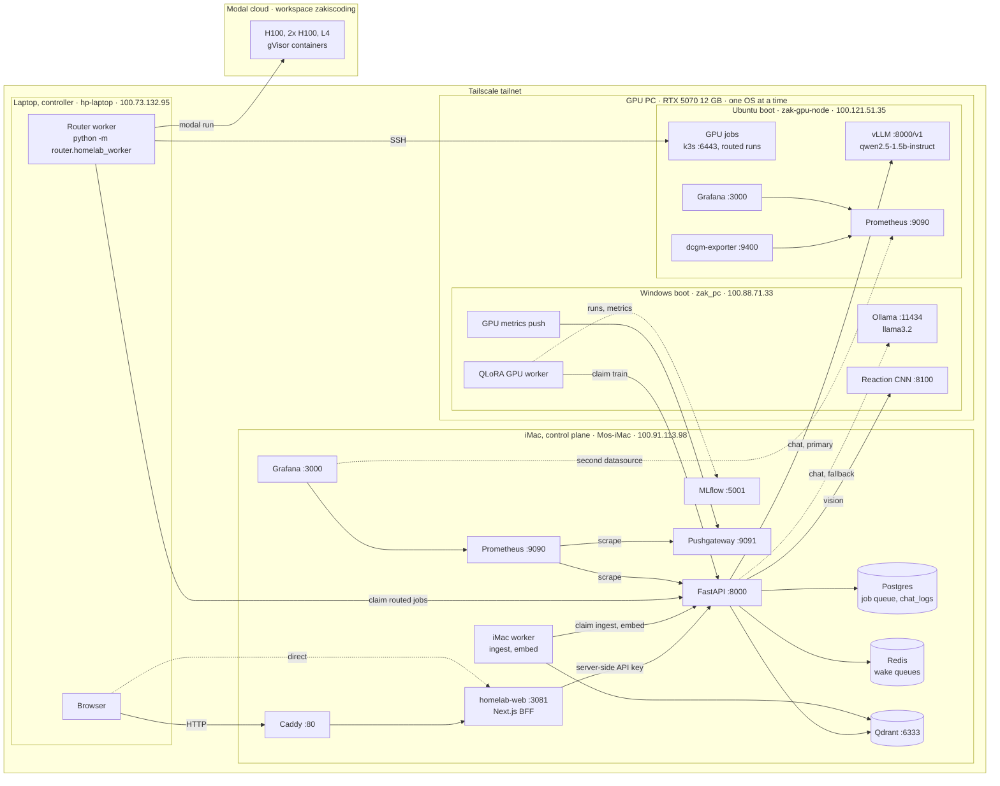
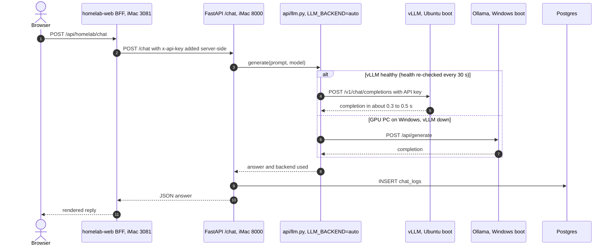
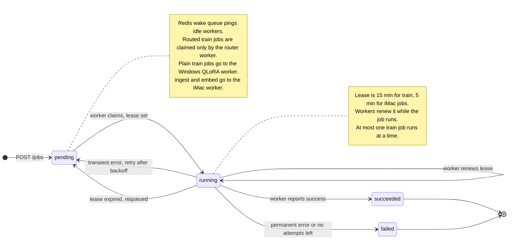
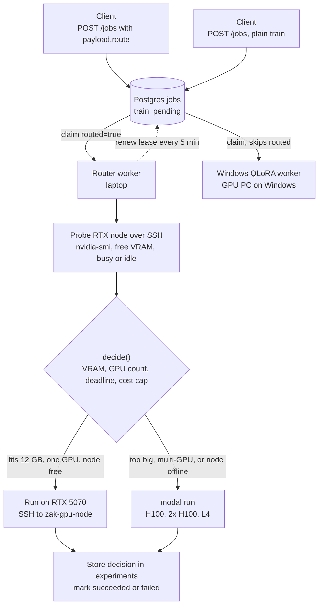
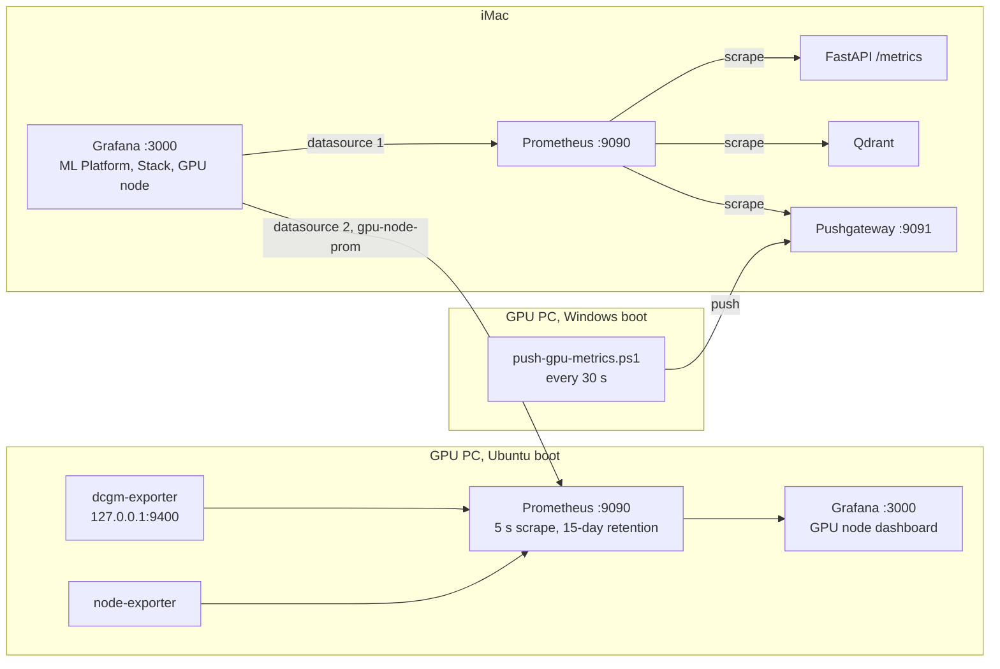

# Architecture

**A self-hosted AI platform across three home machines plus cloud GPUs, joined by Tailscale.**

| Plane | Machine | What it does |
|-------|---------|--------------|
| Control | iMac (`Mos-iMac`, M1) | API, Postgres job queue, Redis, Qdrant RAG, web UI, MLflow, monitoring |
| GPU, Windows boot | GPU PC (`zak_pc`, RTX 5070) | Ollama, QLoRA training worker, reaction CNN, metrics push |
| GPU, Ubuntu boot | GPU PC (`zak-gpu-node`, RTX 5070) | vLLM, CUDA/MPI/NCCL lab, k3s GPU scheduling, DCGM monitoring |
| Controller | Laptop (`hp-laptop`) | Docs, git, SSH, web dev, router worker, Modal client |
| Burst | Modal (cloud) | H100 / 2x H100 / L4 for jobs that don't fit the RTX 5070 |

The GPU PC dual-boots: it runs **Windows or Ubuntu, never both**. The platform is built so either
boot is useful (chat falls back between vLLM and Ollama automatically).

Contents:
[1. Infrastructure topology](#1-infrastructure-topology) ·
[2. Chat request](#2-chat-request) ·
[3. Job lifecycle](#3-job-lifecycle) ·
[4. Job routing](#4-job-routing) ·
[5. Monitoring](#5-monitoring) ·
[Node and port reference](#node-and-port-reference) ·
[Design principles](#design-principles) ·
[Runbooks](#runbooks)

---

## 1. Infrastructure topology

Every machine, every long-running service with its port, and the main traffic between them.
Solid arrows are the primary path; dotted arrows are fallbacks or secondary links.

**How to read it**

- **iMac is the hub.** The browser only talks to the iMac (Caddy `:80` or the web UI `:3081`).
  The Next.js BFF holds the API key server-side and calls FastAPI `:8000`.
- **Postgres is the single source of truth** for jobs. Workers on other machines never touch the
  database; they claim and report through `/internal/worker/*` (worker key).
- **The GPU PC is two different hosts** on the tailnet depending on the boot. On Windows it
  serves Ollama, trains QLoRA adapters and runs the reaction CNN. On Ubuntu it serves vLLM, runs
  k3s GPU jobs and exports DCGM metrics.
- **The laptop runs the router worker.** It has SSH to the GPU node and the Modal client, so it
  can run a routed job on either the local RTX 5070 or a cloud H100.
- **Modal is outside the tailnet.** Jobs reach it with `modal run` from the laptop; the usage limit
  is $10.

---

## 2. Chat request

One chat message from the web UI. The API picks the backend at request time: vLLM when the GPU
PC is on Ubuntu, Ollama when it is on Windows.

| Step | Detail |
|------|--------|
| BFF | The browser never sees the API key. `/api/homelab/*` is an allowlisted proxy in `homelab-web`. |
| Backend choice | `api/llm.py` with `LLM_BACKEND=auto` caches the health result for 30 s, so a reboot into the other OS switches backends within half a minute. |
| vLLM | Always-on Docker container on `zak-gpu-node`, tailnet only, API key required, ~5 GB of VRAM resident. |
| Ollama | Windows scheduled task `HomelabOllamaServe` keeps it on `0.0.0.0:11434`. |
| Logging | Every exchange is written to `chat_logs` in Postgres. |

RAG queries (`POST /rag/query`) follow the same LLM path after a Qdrant retrieval step; ingest and
embedding run as jobs on the iMac worker (fastembed, CPU). See [services/rag.md](services/rag.md).

---

## 3. Job lifecycle

All background work is a row in the Postgres `jobs` table. Workers are stateless; the database
holds the state machine.

| Rule | How it is enforced |
|------|--------------------|
| Claim | `POST /internal/worker/jobs/claim` (train), `claim?routed=true` (router), `claim-imac` (ingest, embed). |
| Lease | `lease_expires_at` set on claim: 15 min for train jobs, 5 min for iMac jobs. Renewed via `POST /internal/worker/jobs/{id}/renew` (the router worker renews every 5 min). |
| Retry | A transient failure returns the job to `pending` with a backoff `scheduled_at`, while attempts remain. |
| Expiry | `expire_stale_leases()` and worker startup `reset-stale` move expired `running` jobs back to `pending`. |
| Wake | On create or requeue the API pushes the job id to a Redis list; workers `BLPOP`, then still claim through Postgres. |
| Inline jobs | `infer` (from `/chat`) and `rag_query` (from `/rag/query`) are executed inline by the API request and recorded for observability; no worker claims them. |
| One train at a time | `claim_train_job` refuses a second running train job; routed jobs share this lock. |

Details: [EXECUTION-MODEL.md](EXECUTION-MODEL.md), [PHASE-0B.md](PHASE-0B.md), [PHASE-4.md](PHASE-4.md).

---

## 4. Job routing

A job submitted with a `route` spec is placed by the router: the local RTX 5070 if it fits and is
free, otherwise the cheapest feasible Modal GPU.

| Input (`payload.route`) | Meaning |
|-------------------------|---------|
| `command` | What to run, e.g. a benchmark script in `gpu-systems-lab` |
| `vram_gb`, `gpus` | Hard requirements; a single 12 GB card rules itself out above these |
| `local_minutes` | Estimated runtime on the RTX 5070; scaled by TFLOPS for other targets |
| `deadline_min`, `max_usd` | Feasibility limits; the worker defaults to a $1 cap per job |

Ordering among feasible targets: the free local card first, then lowest cost, then shortest time to
result. The always-on vLLM counts against free VRAM but does not make the card "busy". If the PC is
booted into Windows, the probe reports the node offline and the job goes to Modal.

Code: `gpu-systems-lab/router/` ([gpu-systems-lab](https://github.com/zakiscoding/gpu-systems-lab)).
End-to-end test: smoke job routed to the local RTX in 21 s.

---

## 5. Monitoring

Two Prometheus servers, one Grafana pane. The iMac Grafana reads both.

| Source | Metrics | Visible in |
|--------|---------|-----------|
| FastAPI `/metrics` | HTTP rate and latency, job queue depth, failures, worker heartbeat age, Redis wake health | iMac Grafana: Homelab ML Platform |
| Pushgateway (Windows boot) | `homelab_gpu_*`, `homelab_host_*`, Ollama and reaction-serve up | iMac Grafana: Homelab Stack |
| dcgm-exporter (Ubuntu boot) | SM active, occupancy, tensor pipe, DRAM, power, temperature, PCIe | GPU node dashboard (21 panels), on both Grafanas |

The GPU node dashboard is empty while the PC runs Windows, and the Pushgateway series go stale
while it runs Ubuntu; that is expected. Prometheus on the GPU node alerts on GPU temperature above
85 °C, VRAM above 95%, XID errors and exporter down. Details: [OBSERVABILITY.md](OBSERVABILITY.md).

---

## Node and port reference

All addresses are Tailscale IPs. Nothing is exposed to the internet by default.

| Node | Tailscale IP | Service | Port | Access |
|------|--------------|---------|------|--------|
| Laptop `hp-laptop` | 100.73.132.95 | Router worker, Modal client, SSH aliases | — | local |
| iMac `Mos-iMac` | 100.91.113.98 | Caddy | 80 | tailnet |
| | | Web UI (homelab-web) | 3081 | tailnet |
| | | FastAPI | 8000 | `x-api-key`; `/internal/worker/*` uses `X-Worker-Key` |
| | | Postgres, Redis | internal | compose network |
| | | Qdrant | 6333 | tailnet |
| | | Prometheus | 9090 | tailnet |
| | | Pushgateway | 9091 | tailnet |
| | | Grafana | 3000 | login |
| | | MLflow | 5001 | tailnet |
| GPU PC, Windows `zak_pc` | 100.88.71.33 | Ollama (`llama3.2`) | 11434 | tailnet, LAN |
| | | Reaction CNN serve | 8100 | tailnet |
| | | QLoRA worker, metrics push | outbound | polls the iMac |
| GPU PC, Ubuntu `zak-gpu-node` | 100.121.51.35 | vLLM (`qwen2.5-1.5b-instruct`) | 8000 (`/v1`) | tailnet, API key |
| | | Grafana | 3000 | tailnet, anonymous view |
| | | Prometheus | 9090 | tailnet |
| | | dcgm-exporter | 9400 | `127.0.0.1` only |
| | | k3s API, kubelet | 6443, 10250 | tailnet, client cert; LAN blocked by ufw |
| | | SSH | 22 | Tailscale SSH (`ssh gpu-ts`); LAN blocked by ufw |
| Modal | — | H100, 2x H100, L4 | — | `modal run` from the laptop; $10 usage limit |

Hardware: GPU PC = RTX 5070 12 GB (sm_120), i7-14700F; Windows on the internal NVMe, Ubuntu 24.04
on an external 698 GB HDD. iMac = Apple M1, macOS 15.7, stack in Colima on a 1 TB external drive.
Full list: [INVENTORY.md](INVENTORY.md). Firewall and exposure: [NETWORK.md](NETWORK.md).

---

## Design principles

| Principle | In practice |
|-----------|-------------|
| **Postgres is the single source of truth** | Job state lives only in the `jobs` table. Workers are stateless and claim through the API; Redis only wakes them. |
| **The iMac owns state, the GPU does compute** | Databases, queue, RAG, keys and dashboards stay on the iMac. The GPU PC runs models and jobs only. |
| **Either boot is useful** | `LLM_BACKEND=auto` keeps chat working on Windows (Ollama) or Ubuntu (vLLM). The router treats an offline node as normal and sends work to Modal. |
| **Leases, not locks** | Every claim carries a lease. A crashed worker's job returns to `pending` on its own; long jobs renew. |
| **Burst to the cloud deliberately** | Local first when the job fits; Modal only when needed, with a per-job cost cap and a $10 account limit. |
| **Tailscale by default** | No port forwarding. Ubuntu-boot admin ports are blocked on the LAN; the API and vLLM require keys. |
| **Secrets stay server-side** | The web BFF holds the API key; `.env` files are never committed. See [ACCESS.md](ACCESS.md) for where credentials live. |
| **One pane of glass** | The iMac Grafana shows platform, Windows GPU and DCGM metrics together. |
| **Measure, then document** | Numbers in these docs come from runs (e.g. RTX 5070 67.7 TFLOPS BF16, H100 677.8; vLLM 4.4k tok/s on the 5070). |

---

## Runbooks

| Node / area | Doc |
|-------------|-----|
| GPU PC, Windows | [nodes/gpu-node.md](nodes/gpu-node.md) · [nodes/GPU-NODE-CHECKLIST.md](nodes/GPU-NODE-CHECKLIST.md) |
| GPU PC, Ubuntu | [nodes/gpu-node-ubuntu.md](nodes/gpu-node-ubuntu.md) |
| iMac | [nodes/imac-node.md](nodes/imac-node.md) · [services/imac-stack.md](services/imac-stack.md) |
| Controller laptop | [nodes/controller.md](nodes/controller.md) |
| Web UI | [services/web-ui.md](services/web-ui.md) |
| Services list | [SERVICES.md](SERVICES.md) |
| Repositories | [REPOS.md](REPOS.md) (five repos) |
| Change history | [SETUP-LOG.md](SETUP-LOG.md) |
