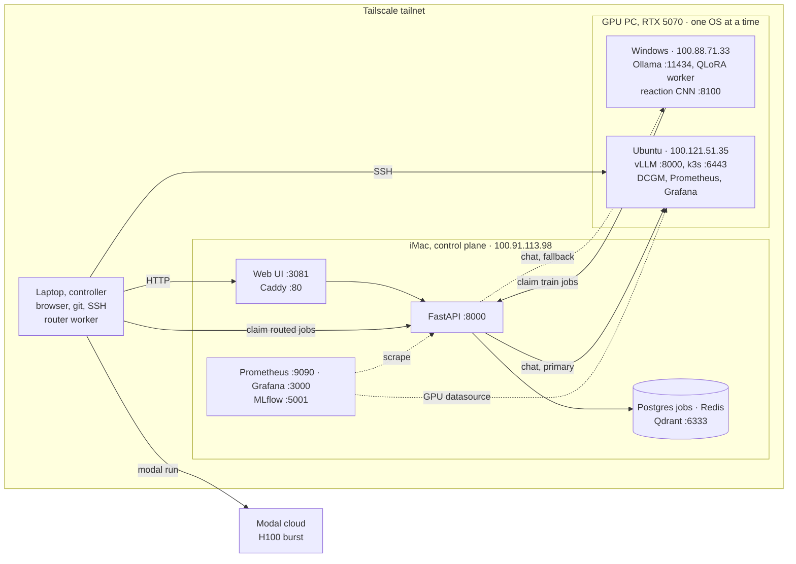

# Homelab — Complete Overview (Shareable Document)

**Document purpose:** Standalone description of the homelab for collaborators, reviewers, or future you.  
**No access required** to other files in the repository — everything essential is here.  
**Last updated:** 2026-10-23 (Ubuntu GPU node, vLLM auto backend, job router, k3s, DCGM, Modal)  
**Owner / GitHub:** [zakiscoding](https://github.com/zakiscoding) (homelab and gpu-systems-lab are public; the rest are private)

---

## 1. Executive summary

This homelab is a **self-hosted AI platform across three home machines plus cloud GPUs**, joined by Tailscale:

1. A **dual-boot GPU desktop** (RTX 5070 12 GB) that runs **Windows or Ubuntu, never both**:
   - **Windows** (`zak_pc`): **Ollama**, **QLoRA fine-tuning**, a **GPU job worker** that polls the iMac, and the reaction CNN.
   - **Ubuntu** (`zak-gpu-node`): **vLLM** (the primary chat backend), a CUDA / MPI / NCCL lab, **k3s** GPU scheduling and **DCGM** GPU monitoring.
2. An **Apple iMac** (`Mos-iMac`) runs the **control plane**: Next.js web UI, FastAPI, Postgres (job queue), Redis, Qdrant (RAG), MLflow, reverse proxy and monitoring — all in Docker via Colima on a 1 TB external drive.
3. A **Windows laptop** (`cashh`) is the **controller**: documentation, Git, browser, SSH (`imac-ts`, `zak-ts`, `gpu-ts`), and the **router worker** that sends GPU jobs to the local RTX 5070 or to the cloud.
4. **Modal** (cloud) provides H100 / 2x H100 / L4 GPUs for jobs that don't fit the RTX 5070 ($10 usage limit).

Machines connect over **home LAN** and **Tailscale**. **Default access is Tailscale only.** The one public path is a Cloudflare LLM gateway, which reaches the GPU through an outbound tunnel with no open ports. A domain with port forwarding for the web UI is documented separately as an option.

**What works today (MVP):**

| Capability | How |
|------------|-----|
| **Web UI** | Chat, RAG, reactions, status at `http://100.91.113.98:3081` (or `:80` via Caddy) |
| **Chat inference** | Browser → iMac web → API → vLLM (Ubuntu boot) or Ollama (Windows boot), chosen automatically (`LLM_BACKEND=auto`) |
| **RAG** | Ingest text → iMac worker embeds → Qdrant → query with citations |
| **Reactions** | Webcam/upload → API `/vision/reaction` → GPU CNN serve `:8100` |
| **Jobs** | Postgres SSOT; GPU, iMac and router workers; leases with renew; Redis wake on job create |
| **Job routing** | Jobs with a `route` spec run on the local RTX 5070 (over SSH) or on Modal H100s, picked by VRAM, GPU count, deadline and cost |
| **GPU scheduling** | k3s single node on the Ubuntu boot, NVIDIA device plugin, GPU admission policy |
| **Training** | QLoRA on GPU (smoke train done; artifacts under `homelab-data/checkpoints/`); optional **distributed** shard plans (Phase 6) |
| **MLflow** | Experiment UI on iMac `:5001` |
| **Monitoring** | Prometheus + Grafana on the iMac (Homelab ML Platform, Homelab Stack, GPU node dashboards) |
| **GPU metrics** | Windows boot: Pushgateway every 30 s. Ubuntu boot: dcgm-exporter → node Prometheus, shown in the iMac Grafana |
| **AI-infra lab** | CUDA kernels, MPI/NCCL, FSDP, vLLM benchmarks on the RTX 5070 and Modal (repo `gpu-systems-lab`) |

**What is intentionally not in public Git:** model weights, datasets, API keys, database passwords, checkpoints, and `.env` files.

---

## 2. High-level architecture



The diagram renders on GitHub. Plain-text version of the original three machines:

```text
                    ┌──────────────────────────────────────┐
                    │  Controller laptop (Windows)         │
                    │  User: cashh                         │
                    │  Browser, git, SSH (imac-ts / zak-ts)│
                    └──────────────────┬───────────────────┘
                                       │ Tailscale / LAN
                   ┌───────────────────┴────────────────────┐
                   │                                        │
        ┌──────────▼──────────┐              ┌─────────────▼─────────────┐
        │  GPU PC (Windows)   │              │  iMac (macOS, M1)         │
        │  zak_pc · zakar       │              │  Mos-iMac · momo            │
        │                       │              │                           │
        │  • Ollama :11434      │◄── HTTP ─────│  • Web UI :3081 / Caddy :80│
        │  • Reaction CNN :8100 │◄── vision ───│  • FastAPI :8000          │
        │  • RTX 5070 12GB      │   inference  │  • Postgres, Redis, Qdrant│
        │  • homelab-gpu        │              │  • MLflow :5001           │
        │  • GPU train worker   │── poll jobs ─│  • imac-worker (RAG/prep) │
        │  • Jupyter :8888      │              │  • Prometheus, Grafana    │
        └─────────────────────┘              └───────────────────────────┘
```

### Request flow (chat via web UI)

1. User opens **http://100.91.113.98:3081** (or `http://100.91.113.98/` via Caddy).
2. **homelab-web** (Next.js) proxies `/api/homelab/chat` to **FastAPI** with `x-api-key` on the server (key never in the browser).
3. FastAPI (`api/llm.py`, `LLM_BACKEND=auto`) calls **vLLM** on the Ubuntu boot (`http://100.121.51.35:8000/v1`, API key) if it is up, otherwise **Ollama** on the Windows boot (`http://100.88.71.33:11434`). Health is re-checked every 30 s.
4. Response returns to the UI (about 0.3–0.5 s on vLLM); the exchange is logged in Postgres `chat_logs`.

### Request flow (RAG)

1. User ingests text in the **RAG** tab → API creates ingest + embed jobs.
2. **imac-worker** chunks and embeds (fastembed, CPU), stores vectors in **Qdrant**.
3. User queries → API searches Qdrant → LLM answer with citations.

### Request flow (reactions / vision)

1. User opens **/reactions** in homelab-web → captures frame or uploads image.
2. Next.js BFF calls **`POST /vision/reaction`** on the iMac API.
3. FastAPI forwards to **GPU reaction serve** (`:8100`).
4. Label + confidence return to the UI (FER-style classes).

### Request flow (routed GPU job)

1. A client submits `POST /jobs` with a `route` spec (command, VRAM, GPUs, estimated minutes, cost cap).
2. The **router worker** on the laptop claims it (the Windows QLoRA worker skips routed jobs) and renews the lease every 5 min.
3. It probes the RTX node over SSH and picks the free local card if the job fits, else the cheapest feasible **Modal** GPU.
4. The job runs over SSH on `zak-gpu-node` or via `modal run`; the decision is stored as the job's experiment.

### Design principles

| Principle | Rationale |
|-----------|-----------|
| **GPU does heavy ML** | VRAM for vLLM / Ollama + training; iMac M1 runs services only |
| **Either boot is useful** | Chat falls back between vLLM and Ollama; the router sends work to Modal when the node is offline |
| **iMac owns state** | Postgres job plane, RAG, metrics, API keys |
| **Five Git repos** | Docs, iMac stack, web UI, Windows GPU code, Ubuntu GPU lab — see §5 |
| **Private GitHub** | No secrets in git |
| **Tailscale default** | Remote ops without WAN port-forward |
| **Web BFF** | API key stays on iMac in the Next.js server layer |

---

## 3. Hardware and identities

| Machine | Hostname | OS | Primary user | Hardware notes |
|---------|----------|-----|--------------|----------------|
| **GPU desktop, Windows boot** | `zak_pc` | Windows | `zakar` | NVIDIA GeForce **RTX 5070**, 12 GB VRAM, i7-14700F |
| **GPU desktop, Ubuntu boot** | `zak-gpu-node` | Ubuntu 24.04 (external 698 GB HDD) | `zak` | Same PC; runs Windows **or** Ubuntu, never both |
| **iMac** | `Mos-iMac` | macOS 15.7 | `momo` | **Apple M1** |
| **Laptop** | `hp-laptop` | Windows | `cashh` | Controller; runs the router worker and Modal client |
| **Cloud** | Modal `zakiscoding` | gVisor containers | — | H100 / 2x H100 / L4, $10 usage limit |

**Important:** GPU PC is **`zakar`**; laptop is **`cashh`**. They are different machines.

---

## 4. Network and access

### Local network (example)

| Node | LAN IPv4 | Notes |
|------|----------|-------|
| GPU PC | `10.0.0.156` | Ollama `11434`, Jupyter `8888` |
| iMac | (DHCP) | Web `3081`, Caddy `80`, API `8000`, Grafana `3000`, MLflow `5001` |
| Home gateway | `10.0.0.1` | Typical |

### Tailscale (primary remote access)

| Node | Tailscale IPv4 | Key services |
|------|----------------|--------------|
| GPU PC, Windows | `100.88.71.33` | Ollama `:11434`, reaction serve `:8100` |
| GPU PC, Ubuntu | `100.121.51.35` | vLLM `:8000/v1`, Grafana `:3000`, Prometheus `:9090`, k3s `:6443` |
| iMac | `100.91.113.98` | Web UI `:3081`, Caddy `:80`, API `:8000`, Grafana `:3000`, MLflow `:5001` |
| Laptop | `100.73.132.95` | Controller |

### Security posture

- GitHub repos are **private**.
- **Do not** port-forward Ollama (`11434`) or internal API (`8000`) to the internet.
- Web UI uses server-side API proxy; direct API calls still need `x-api-key`.
- Optional public HTTPS: domain + router `80/443` → iMac Caddy only (see homelab `docs/deploy/public-internet.md`).
- GPU firewall (Windows): **Ollama LAN** rule; Ollama bound via `OLLAMA_HOST=0.0.0.0:11434`.
- GPU node (Ubuntu): ufw blocks 22/6443/10250 on the LAN; vLLM requires an API key; SSH is Tailscale SSH.

---

## 5. GitHub repositories (five-repo model)

| Repository | GitHub | Runs on | Contains |
|------------|--------|---------|----------|
| **homelab** | [zakiscoding/homelab](https://github.com/zakiscoding/homelab) | All nodes (docs) | Markdown, architecture, phases, setup log |
| **homelab-services** | [zakiscoding/homelab-services](https://github.com/zakiscoding/homelab-services) | **iMac** | Docker Compose, FastAPI, Caddy, workers, DB migrations |
| **homelab-gpu** | [zakiscoding/homelab-gpu](https://github.com/zakiscoding/homelab-gpu) | **GPU PC** | Training scripts, GPU worker, Ollama helpers, notebooks |
| **homelab-web** | [zakiscoding/homelab-web](https://github.com/zakiscoding/homelab-web) | **Laptop dev**, **iMac prod** `:3081` | Next.js UI — chat, RAG, reactions, status |
| **gpu-systems-lab** | [zakiscoding/gpu-systems-lab](https://github.com/zakiscoding/gpu-systems-lab) | **GPU PC on Ubuntu**, Modal, laptop | CUDA kernels, MPI/NCCL, FSDP, vLLM, k3s, DCGM observability, job router |

### Local paths (canonical copies)

| Machine | homelab | homelab-services | homelab-gpu | homelab-web |
|---------|---------|------------------|-------------|-------------|
| **iMac** | `…/homelab` | `…/homelab-services` | `…/homelab-gpu` (mirror) | `…/homelab-web` (sibling) |
| **Laptop** | `C:\Users\cashh\homelab` | optional clone | — | `C:\Users\cashh\homelab-web` |
| **GPU PC** | optional | — | `C:\Users\zakar\homelab-gpu` | — |

**Workflow:** `git pull` → edit → `git commit` → `git push`. Secrets only in `.env` / `.env.local` (never committed).

---

## 6. GPU node (`zak_pc`) — inference and training

**Rule:** GPU runs **ML and the train worker only** — not Postgres, Redis, Grafana, Qdrant, or the main API.

### 6.1 Inference — Ollama

| Item | Detail |
|------|--------|
| Software | [Ollama](https://ollama.com) on Windows |
| Port | `11434` on `0.0.0.0` (`OLLAMA_HOST=0.0.0.0:11434`) |
| Model (example) | `llama3.2:latest` |
| **Persistent start** | Scheduled task **`HomelabOllamaServe`** → `homelab-gpu/scripts/serve-ollama.bat` |
| Quick recovery | `schtasks /Run /TN HomelabOllamaServe` |

**Health check (from laptop):**

```text
GET http://100.88.71.33:11434/api/tags
```

If this fails, the web UI chat stays on “Thinking…”.

**Scripts (homelab-gpu):**

| Script | Purpose |
|--------|---------|
| `install-ollama-serve-task.ps1` | One-time Admin setup — task + firewall |
| `start-ollama.ps1` | Quick start / run task |
| `stop-ollama.ps1` | Free VRAM before training |

### 6.2 Training and GPU worker

| Item | Path or tool |
|------|----------------|
| Repo | `C:\Users\zakar\homelab-gpu` |
| Python | 3.12, `.venv`, PyTorch (CUDA 12.8 for RTX 5070) |
| Training | `training/lora_quickstart/train.py` — QLoRA smoke **succeeded** |
| Worker | Polls iMac `POST /internal/worker/jobs/claim` for `train` jobs |
| Data (local) | `C:\Users\zakar\homelab-data\` — datasets, checkpoints |
| Jupyter | `scripts/start-jupyter.ps1` → `:8888` |
| Metrics | `scripts/push-gpu-metrics.ps1` → iMac Pushgateway `:9091` |

**Before long training:** `stop-ollama.ps1` to free VRAM.

---

### 6.3 Ubuntu boot (`zak-gpu-node`) — AI-infra lab

| Item | Detail |
|------|--------|
| OS | Ubuntu 24.04 on an external 698 GB HDD; Tailscale `100.121.51.35`; `ssh gpu-ts` |
| Toolchain | CUDA 13.2, LLVM 21, Docker + NVIDIA Container Toolkit, PyTorch 2.11, Open MPI 4.1.6 |
| Serving | vLLM, `qwen2.5-1.5b-instruct`, always-on Docker on tailnet `:8000/v1` with an API key — the homelab chat backend |
| Scheduling | k3s single node, NVIDIA device plugin, admission policy requires GPU limits |
| Monitoring | dcgm-exporter → Prometheus `:9090` → Grafana `:3000`; also a datasource in the iMac Grafana |
| Repo | [gpu-systems-lab](https://github.com/zakiscoding/gpu-systems-lab) |

Measured: RTX 5070 BF16 67.7 TFLOPS vs H100 677.8 (10x); vLLM 4.4k tok/s on the 5070 vs 16.8k on an H100; 2x H100 NCCL all-reduce 329 GB/s.

## 7. iMac node (`Mos-iMac`) — application stack

### 7.1 Docker runtime

| Item | Detail |
|------|--------|
| Runtime | **Colima** on 1 TB drive |
| Colima | `/Volumes/1tb drive/homelab-runtime/colima` |
| Compose | `/Volumes/1tb drive/homelab-services` |
| Symlink | `~/1tb-drive/homelab-services` (paths with spaces) |

**Always before docker commands:** `source ./scripts/docker-1tb-env.sh`

Key scripts: `setup-1tb.sh`, `start-stack.sh`, `ensure-homelab-web.sh`, `render-caddyfile.sh`, `bootstrap-env.sh`.

### 7.2 Running containers

| Container | Purpose | Tailscale port |
|-----------|---------|----------------|
| **web** | Next.js UI (homelab-web) | **3081** |
| **caddy** | Reverse proxy → `web:3000` | **80**, 443 |
| **api** | FastAPI — chat (vLLM / Ollama), RAG, vision, jobs, metrics | **8000** |
| **imac-worker** | RAG ingest/embed + train_prep | internal |
| **mlflow** | Experiment tracking UI | **5001** |
| **postgres** | Jobs, chat logs, RAG metadata | internal |
| **redis** | Counters, job wake queues | **6379** (GPU worker) |
| **qdrant** | Vector search | **6333** |
| **prometheus** | Metrics scrape | **9090** |
| **grafana** | Dashboards | **3000** |
| **pushgateway** | GPU metric push | **9091** |

### 7.3 API surface (summary)

| Area | Endpoints | Auth |
|------|-----------|------|
| Health | `/health`, `/health/gpu` | None / LAN |
| Chat | `POST /chat` | `x-api-key` |
| RAG | `POST /rag/ingest`, `POST /rag/query`, `GET /rag/status` | `x-api-key` |
| Vision | `GET /vision/status`, `POST /vision/reaction` | `x-api-key` |
| Jobs | `POST /jobs`, `GET /jobs/{id}` | `x-api-key` |
| Models | `GET /models` (Ollama tags on GPU) | `x-api-key` |
| Workers | `/internal/worker/*` | `X-Worker-Key` |
| Metrics | `GET /metrics` | LAN/Tailscale |
| System | `GET /system/status` | `x-api-key` |

The **web UI** calls these through `/api/homelab/*` on the Next.js server (browser never holds the API key).

### 7.4 Web UI (homelab-web)

| Item | Detail |
|------|--------|
| Repo | [github.com/zakiscoding/homelab-web](https://github.com/zakiscoding/homelab-web) |
| Production URL | http://100.91.113.98:3081 or http://100.91.113.98/ |
| Pages | `/` overview, `/chat`, `/rag`, `/reactions` |
| Chat UX | GPU health banner; 2-minute client timeout; clearer 502 when no LLM backend is up |
| Dev | `npm run dev` on laptop → `http://localhost:3000` |
| Deploy | `ensure-homelab-web.sh` then `docker-compose up -d --build web caddy` on iMac |

---

## 8. Controller laptop (`cashh`)

| Responsibility | Detail |
|----------------|--------|
| Documentation | Edit **homelab**, push to GitHub |
| Web dev | **homelab-web** locally |
| Browser | Production UI on iMac Tailscale IP |
| SSH | `ssh imac-ts` (iMac), `ssh zak-ts` (GPU, Windows), `ssh gpu-ts` (GPU, Ubuntu) — `~/.ssh/config` |
| Router worker | `python -m router.homelab_worker` in `gpu-systems-lab` — routed jobs to the RTX 5070 or Modal |
| Testing | `curl.exe`, PowerShell `Invoke-RestMethod` |

The laptop does **not** need Docker or Ollama for the homelab to run; it is only needed for routed jobs.

**Deploy UI to iMac (example):**

```bash
ssh imac-ts
cd ~/1tb-drive/homelab-services && git pull
./scripts/ensure-homelab-web.sh
source ./scripts/docker-1tb-env.sh
./scripts/render-caddyfile.sh
docker-compose up -d --build web caddy
```

---

## 9. 1TB external drive layout (iMac)

```text
/Volumes/1tb drive/
├── homelab/              ← documentation (git)
├── homelab-services/     ← Docker stack (git)
├── homelab-web/          ← Next.js UI (git, sibling of services)
├── homelab-gpu/          ← training mirror (git, optional)
├── homelab-runtime/      ← Colima (not git)
└── Personal/             ← non-homelab
```

Persistent service data: `homelab-services/data/` (Postgres, Grafana, Qdrant, etc.).

---

## 10. Platform phases (what was built)

| Phase | Theme | Status |
|-------|--------|--------|
| **0A** | Job control plane, GPU worker, leases | Done |
| **0B** | Retry, stale jobs, `/system/status`, ML-STORE paths | Done |
| **1** | `/chat` inference + infer jobs | Done |
| **2** | RAG — ingest, embed, Qdrant, `/rag/query` | Done |
| **3** | QLoRA training smoke on GPU | Done |
| **4** | Redis job wake (LPUSH / BLPOP) | Done |
| **5** | Prometheus, Pushgateway, Grafana dashboards | Done |
| **Web UI** | homelab-web on `:3081` | Done (May 2026) |
| **6** | Distributed train plans, MLflow, vision/reactions API | Done (May 2026) |
| **GPU node, Ubuntu** | CUDA/MPI/NCCL lab, k3s, DCGM, Modal burst | Done (Oct 2026) |
| **One platform** | vLLM chat backend, unified Grafana, router → job queue | Done (Oct 2026) |

**Not in MVP yet (optional):** served LoRA adapter in Ollama, public domain HTTPS, full user auth in UI, GPU reaction-serve install scripts in homelab-gpu repo.

---

## 11. Status snapshot

| Area | Status | Notes |
|------|--------|-------|
| Documentation scaffold | Done | 2026-05-21 |
| Architecture | Documented | Diagrams in `docs/ARCHITECTURE.md` |
| GPU node — Ollama | Done | RTX 5070; `100.88.71.33:11434` |
| iMac — API/DB (Colima) | Done | Stack + web UI `:3081`; `100.91.113.98` |
| Web UI (homelab-web) | Done | Chat, RAG, overview over Tailscale |
| GPU Ollama (persistent) | Done | `HomelabOllamaServe` on `zak_pc` |
| Docs on 1TB drive | Done | `/Volumes/1tb drive/homelab` |
| Services on 1TB drive | Done | `/Volumes/1tb drive/homelab-services` |
| GitHub repos | Done | Public: homelab, gpu-systems-lab. Private: homelab-services, homelab-web, homelab-gpu |
| Cloudflare LLM gateway | Running | Public API for the GPU with keys, rate limit and Workers AI fallback; tunnel, no open ports |
| Monitoring | Running | Prometheus `:9090`, Grafana `:3000` on iMac |
| Tailscale E2E tests | Done | GPU + iMac health; UI chat/RAG from laptop |
| GPU training prep | Done | homelab-gpu cloned, Python, torch, data dirs |
| QLoRA smoke train | Done | Phase 3 via GPU worker (`lora_quickstart/train.py`) |
| Backups | Documented | `BACKUPS.md` + `backup-postgres.sh` (cron **Next**) |
| LoRA → Ollama inference | **Ready** | `homelab-gpu/scripts/publish-lora-to-ollama.ps1` → Chat model `homelab-*` |
| CNN image fine-tune | **Ready** | CIFAR-10 or FER2013 — [CNN-FINETUNE.md](../docs/CNN-FINETUNE.md) |
| Reaction vision (FER) | **Live in web UI** | `/reactions` on `:3081` — [GPU-TRAIN.md](../docs/GPU-TRAIN.md) |
| GPU node — Ubuntu boot | Done | `zak-gpu-node`, CUDA 13.2, k3s, DCGM; LAN hardening verified |
| Chat backend | Running | `LLM_BACKEND=auto`: vLLM on Ubuntu, Ollama on Windows |
| Router worker | Done | Routed jobs → RTX 5070 or Modal |

- [x] Five-repo layout on GitHub (homelab, services, gpu, web + gpu-systems-lab)  
- [x] GPU: Ollama, Tailscale, `HomelabOllamaServe`, training env, QLoRA smoke  
- [x] iMac: full compose stack + web UI + RAG worker  
- [x] Tailscale E2E: UI, chat, RAG, reactions, Grafana  
- [x] Job plane + Redis wake + observability  
- [x] Vision proxy + reactions page; MLflow `:5001`  
- [x] Phase 6 distributed train schema + train_prep worker  
- [x] GPU PC Ubuntu boot (`zak-gpu-node`): CUDA 13.2, k3s GPU scheduling, DCGM monitoring, hardening  
- [x] Chat on vLLM with Ollama fallback (`LLM_BACKEND=auto`); unified Grafana  
- [x] Router worker: routed jobs → local RTX 5070 or Modal H100s  

Canonical copy also lives in [README.md](../README.md#status) in the homelab repo.

### Sensible next steps

- [ ] Scheduled Postgres backups on iMac (`backup-postgres.sh`)  
- [ ] Publish latest train job: `publish-lora-to-ollama.ps1 -JobId <uuid>` on GPU  
- [ ] Optional: sync adapter archive to iMac ML-STORE  
- [ ] Redeploy web + API on iMac after BFF/error-handling fixes (if not yet pulled)  
- [ ] Optional: public domain + HTTPS (homelab deploy doc)  
- [ ] After GPU reboot: confirm `schtasks /Run /TN HomelabOllamaServe`  

---

## 12. Quick reference — URLs (Tailscale)

| Service | URL |
|---------|-----|
| **Web UI (primary)** | http://100.91.113.98:3081 |
| **Reactions UI** | http://100.91.113.98:3081/reactions |
| **Web UI (Caddy)** | http://100.91.113.98/ |
| GPU Ollama health (Windows boot) | http://100.88.71.33:11434/api/tags |
| GPU vLLM (Ubuntu boot, API key) | http://100.121.51.35:8000/v1/models |
| GPU node Grafana (Ubuntu boot) | http://100.121.51.35:3000/d/gpu-node |
| GPU reaction health | http://100.88.71.33:8100/health |
| iMac API health (ops) | http://100.91.113.98:8000/health |
| MLflow | http://100.91.113.98:5001 |
| Grafana | http://100.91.113.98:3000 |
| Prometheus | http://100.91.113.98:9090 |
| Pushgateway | http://100.91.113.98:9091 |
| Qdrant | http://100.91.113.98:6333 |
| Jupyter (GPU, if started) | http://100.88.71.33:8888 |

---

## 13. Troubleshooting (common)

| Symptom | Likely cause | Fix |
|---------|--------------|-----|
| `:3081` connection refused | `web` container down on iMac | `docker-compose up -d web` (+ `source docker-1tb-env.sh`) |
| Reactions “vision down” | GPU reaction serve not on `:8100` | Start serve on zak_pc; check `GPU_VISION_URL` in `.env` |
| Webcam blocked on Tailscale | HTTP lacks secure context | Use **Upload photo** or SSH tunnel to `https://localhost:3081` |
| Chat “Thinking…” forever | No LLM backend up | Ubuntu boot: check vLLM (`docker compose ps` in `serving/`). Windows boot: `curl` GPU tags; `schtasks /Run /TN HomelabOllamaServe` |
| Chat 502 | iMac cannot reach vLLM `:8000` or Ollama `:11434` | Check `LLM_*` / `GPU_URL` in `.env`, firewall, which OS the GPU PC is booted into |
| RAG query empty | Embed not finished | Wait 30–90s after ingest; check `imac-worker` logs |
| `docker ps` empty on iMac | Wrong Docker context | `source scripts/docker-1tb-env.sh` |

---

## 14. Glossary

| Term | Meaning |
|------|---------|
| **Ollama** | Local LLM server on the GPU PC's Windows boot, port 11434 |
| **vLLM** | High-throughput LLM server on the GPU PC's Ubuntu boot, port 8000 |
| **Router worker** | Laptop process that runs routed jobs on the RTX 5070 or Modal |
| **k3s** | Lightweight Kubernetes; single node on the Ubuntu boot for GPU jobs |
| **DCGM** | NVIDIA Data Center GPU Manager; its exporter feeds GPU metrics to Prometheus |
| **Modal** | Serverless cloud GPUs (H100, L4) used for burst jobs |
| **homelab-web** | Next.js UI; BFF hides API key |
| **Colima** | Docker VM on macOS (iMac) |
| **LoRA / QLoRA** | Efficient fine-tuning on consumer GPUs |
| **Tailscale** | Mesh VPN for home machines |
| **imac-worker** | Container that runs RAG ingest/embed jobs |
| **BFF** | Backend-for-frontend — Next.js `/api/homelab` proxy |
| **Caddy** | Reverse proxy; LAN mode forwards `:80` → web UI |
| **Qdrant** | Vector DB for RAG |
| **Pushgateway** | Prometheus target for GPU-pushed metrics |
| **MLflow** | Experiment tracking server on iMac |
| **train_prep** | iMac job that builds shard plan before GPU train |
| **Reaction serve** | GPU FastAPI/CNN on port 8100 for `/vision/reaction` |

---

## 15. Contact and repository access

- GitHub user: **zakiscoding**  
- Private repo access must be granted by the owner.  
- This document contains **no** passwords, API keys, or tokens.

After joining the project: clone **homelab**, read `docs/SETUP-LOG.md` for build history, `docs/services/web-ui.md` for the browser UI, and `docs/services/vision-reactions.md` for the reactions pipeline.

---

*End of shareable overview.*
